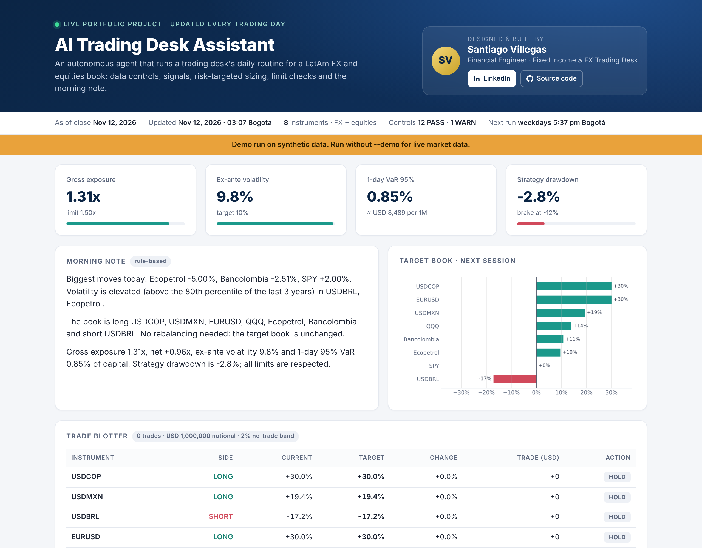
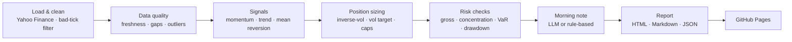

# AI Trading Desk Assistant

**Designed and built by [Santiago Villegas](https://www.linkedin.com/in/santiago-villegas-a1a6ba345/)**, financial engineer on a fixed income and FX trading desk (Medellín, Colombia).

**An automated, process-driven daily workflow for a multi-asset book (LatAm FX + US and Colombian equities).**
Every weekday after the close, an agent downloads market data, runs data-quality controls, scores each
instrument, sizes a risk-targeted book, checks it against desk limits, writes the morning note and publishes
a report to GitHub Pages. No manual steps.

### 👉 [Live report](https://santiago0132004.github.io/ai-trading-desk-assistant/) · refreshed every trading day at 5:37 pm Bogotá


<sub>Preview generated with the built-in demo data. The live site uses real market data from Yahoo Finance.</sub>

---

## Why I built it

On a fixed income and FX desk, the edge is not just the model. It's the **process**: clean data, clear
signals, hard risk limits, documented controls and a note that the team can read in two minutes. This project
automates that whole routine end to end and keeps an audit trail of every decision, so it can be reviewed
like a real desk's workflow.

## What the agent does every day



| Step | What happens | Output |
|---|---|---|
| 1. Load & clean | Daily closes for 4 FX pairs (USD/COP, USD/MXN, USD/BRL, EUR/USD) and 4 equities (SPY, QQQ, Ecopetrol, Bancolombia). A bad-tick filter repairs one-day FX spikes that fully reverse (common in free data feeds) and logs every fix | Clean price panel |
| 2. Data quality | Flags stale data, missing values and moves beyond 6σ | PASS / WARN in the control log |
| 3. Signals | Vol-adjusted time-series momentum (1–12m), 50/200 trend filter and RSI mean reversion, blended into a score in [-1, 1] | Signal table |
| 4. Sizing | Inverse-volatility weights, long-only for equities, 30% cap per instrument, scaled to a 10% annual volatility target using the covariance matrix | Target book |
| 5. Risk checks | Gross leverage, concentration, ex-ante volatility, 1-day 95% historical VaR, drawdown brake (halves exposure past -12%) | Limit checks |
| 6. Trade blotter | Current vs target weights, BUY / SELL / HOLD, USD notional per $1M, with a 2% no-trade band to avoid noise trades | Blotter |
| 7. Morning note | Written by Claude from the run's structured JSON when `ANTHROPIC_API_KEY` is set, deterministic rules otherwise | 3-paragraph note |
| 8. Publish | HTML report, Markdown note and JSON audit file deployed to GitHub Pages by GitHub Actions | Live site |

## Built to be trusted

- **No look-ahead.** Weights decided at the close of day *t* only earn day *t+1* returns. A unit test shocks
  future prices and checks that today's signals do not change.
- **Net of costs.** 2 bps per trade on FX and 5 bps on equities, plus turnover and cost-drag metrics.
- **Hard limits, tested.** Tests verify per-instrument caps, gross leverage and the long-only constraint on
  every day of the backtest.
- **Fails safe.** If the LLM is unavailable, the run falls back to the rule-based note and logs a WARN.
  Instruments with no data are dropped and logged instead of crashing the run.
- **Clean data first.** Free FX feeds contain bad prints that inflate volatility and distort sizing. The agent
  repairs one-day spikes that fully reverse while keeping genuine repricings, and a unit test checks both cases.
- **Auditable.** Every step writes PASS / WARN / FAIL with a reason to the control log and `desk_run.json`.

## Run it locally

```bash
git clone https://github.com/santiago0132004/ai-trading-desk-assistant.git
cd ai-trading-desk-assistant
pip install -r requirements.txt

python -m desk run --demo      # full workflow on synthetic data, no internet needed
python -m desk run             # live market data -> docs/index.html
python -m desk backtest        # backtest metrics only
python -m pytest -q            # 9 tests
```

Optional LLM commentary:

```bash
export ANTHROPIC_API_KEY=sk-ant-...
export ANTHROPIC_MODEL=claude-sonnet-4-5   # any available Claude model
python -m desk run
```

Everything (author card, universe, lookbacks, risk limits, costs) lives in [`config.yaml`](config.yaml).
Edit it on GitHub and the next run picks up the change automatically.

## Project structure

```
desk/
  data.py       market data (Yahoo Finance) and seeded synthetic data
  signals.py    momentum, trend, RSI mean reversion, composite score
  risk.py       inverse-vol sizing, vol targeting, VaR, drawdown
  backtest.py   walk-forward backtest with costs, no-trade band and drawdown brake
  agent.py      the daily workflow: checklist, control log, trade blotter, commentary
  report.py     charts and HTML / Markdown / JSON report
  templates/    report template
tests/          unit and end-to-end tests
.github/workflows/daily-desk.yml   tests + daily run + GitHub Pages deploy
```

## Possible extensions

Colombian TES yield curve (Nelson-Siegel) as a rates sleeve, carry signals from interest-rate differentials,
Slack or email delivery of the morning note, and a paper-trading connector.

---

**Santiago Villegas** · Financial Engineer (Universidad EIA) · AMV-certified operator · Fixed income & FX trading desk ·
[LinkedIn](https://www.linkedin.com/in/santiago-villegas-a1a6ba345/)

*For research and education only. Not investment advice.*
